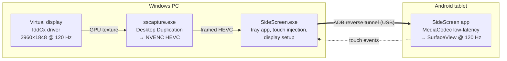

<div align="center">


# SideScreen

**Use your Android tablet as a second monitor for Windows, over a USB cable.**
Native resolution at 120 Hz, with touch. No Wi-Fi, no account, no subscription.

[](https://github.com/unlimiteq/SideScreen/releases/latest)
[](https://github.com/unlimiteq/SideScreen/actions/workflows/build.yml)
[](LICENSE)


[**Download**](https://github.com/unlimiteq/SideScreen/releases/latest) ·
[Quick start](#quick-start) ·
[How it works](#how-it-works) ·
[Compatibility](#compatibility) ·
[FAQ](#faq)

</div>

---

## Features

|  |  |
| --- | --- |
| 🖥️ **A real extended display** | Windows treats the tablet as another monitor. You can drag windows onto it, put it to the left, right, above or below your main screen, and change it in Display Settings. |
| ⚡ **120 Hz at native resolution** | On a Galaxy Tab S8 Ultra that's 2960 × 1848 at 120 Hz. Capture and encoding happen on the GPU and take about 4 ms per frame. |
| 📐 **Custom resolution and refresh rate** | Type in any size and refresh rate you want. SideScreen adds the mode to the virtual display by itself, without an admin prompt. |
| 🔌 **USB only** | The picture goes over the cable through an ADB tunnel, so there's no network setup or pairing, and Wi-Fi interference can't cause lag spikes. |
| 👆 **Multi-touch** | Touching the tablet works like a Windows touchscreen, with up to 10 fingers. |
| 🖱️ **Smooth pointer** | The tablet draws the mouse pointer itself, so it keeps moving smoothly even when the screen is busy. |
| 🪞 **Mirror mode** | You can show one of your existing screens on the tablet instead of extending the desktop. |
| 🧰 **Tray app** | SideScreen sits in the system tray. The icon gets a green dot while streaming, and you can start or stop from the tray menu or with **Ctrl + Alt + S** from any app. |
| 🔔 **Alerts (optional)** | You get a notification when the tablet connects or disconnects, or when streaming stops on its own. A single setting turns them off. |
| 🔁 **Hands-off** | It can start streaming as soon as you plug the tablet in and launch with Windows. If the connection drops, an app restarts or the PC locks, it reconnects without you doing anything. |
| 📊 **Stats overlay** | Tap the tablet with three fingers to see fps, bitrate and decode time. |
| 🔒 **Private** | There's no account and no telemetry. The app only goes online to check for updates, and only when you click that link. |

## Quick start

1. **Tablet:** turn on [Developer options → USB debugging](https://developer.android.com/studio/debug/dev-options#enable), plug the tablet into your PC, and accept the *Allow USB debugging* prompt.
2. **PC:** download `SideScreen-vX.Y.Z-win-x64.zip` from [Releases](https://github.com/unlimiteq/SideScreen/releases/latest), unzip it wherever you like, and run `SideScreen.exe`.
   You'll need the [.NET 10 Desktop Runtime](https://dotnet.microsoft.com/download/dotnet/10.0). If it isn't installed, Windows will offer to download it.
3. Click **Install virtual display driver**. You only do this once, and it asks for admin rights.
4. Press **Start**. SideScreen installs and opens the tablet app for you, and the tablet becomes your second screen.

> [!TIP]
> In Extend mode the tablet starts out showing an empty piece of desktop, so with a black wallpaper it looks blank until you move the mouse or a window over. A banner on the tablet tells you when it's connected.

## Compatibility

| Component | Requirement | Notes |
| --- | --- | --- |
| **Windows** | Windows 11, Windows 10 (21H2+) x64 | Extend mode uses the virtual display driver (IddCx), which comes with SideScreen. |
| **GPU** | NVIDIA GeForce GTX 10-series or newer | SideScreen encodes with NVENC HEVC, so the screen it captures has to run on the NVIDIA GPU. On Optimus laptops the virtual display does. AMD and Intel encoders aren't supported yet. |
| **Android** | Android 11 (API 30) or newer | The tablet needs a hardware HEVC decoder. Almost every tablet made since 2018 has one. |
| **Connection** | USB 2.0 or faster cable | Use USB 3 if you want the *Max* quality setting. |

**Tested on**

| Tablet | Panel | Result |
| --- | --- | --- |
| Samsung Galaxy Tab S8 Ultra (SM-X900, Android 16) | 2960 × 1848 @ 120 Hz | ✅ 119–120 fps at native resolution, touch, Extend and Mirror |

If you've tried it on another device, please [open an issue](https://github.com/unlimiteq/SideScreen/issues/new?template=device_report.yml) with the result and I'll add it to the table.

## How it works

The tablet's USB port can't take a video signal. So SideScreen gives Windows a virtual monitor and sends that monitor's picture to the tablet. Frames stay on the GPU the whole way, and nothing waits in a queue.



| Stage | What happens | Why it is fast |
| --- | --- | --- |
| Virtual display | An indirect display driver adds a 2960 × 1848 @ 120 Hz monitor to Windows. | Windows draws to it like any other screen, so every app and game works on it. |
| Capture | Desktop Duplication wakes up exactly when a new frame is presented. | It reacts to new frames instead of polling, and the frame stays in VRAM. |
| Encode | NVENC HEVC with ultra-low-latency tuning, no B-frames, infinite GOP. | It takes about 3.5–5 ms per frame. Frames that haven't changed aren't sent again, and a few extra frames sharpen a still image. |
| Transport | Length-prefixed packets over `adb reverse` on the USB cable. | TCP_NODELAY and a small send buffer keep old frames from piling up. |
| Decode | Android MediaCodec with `low-latency` and no frame dropping. | Each frame shows up on the next refresh of the tablet's screen. |
| Pointer & touch | The pointer's shape and position are sent separately; touches go in through `InjectTouchInput`. | The pointer never waits for a video frame. |

The PC also sends a heartbeat every second. That lets the tablet tell an idle desktop apart from a pulled cable, so it shows a *Connection lost* screen instead of a frozen picture.

## Using SideScreen

| Setting | What it does |
| --- | --- |
| **Display** | *Extend* adds the tablet as a new screen; *Mirror* shows an existing screen. |
| **Resolution** | Native, 2560 × 1600, 1920 × 1200, or *Custom…* to type any width and height. Lower resolutions make text bigger. Extend only. |
| **Tablet position** | Right, left, above or below your PC screen. Extend only. |
| **Refresh rate** | 120, 90 or 60 Hz, or *Custom…* for anything from 24 to 240 Hz. It never goes above what the tablet's screen can show. |
| **Quality** | 150 / 80 / 40 / 20 Mbps. Higher settings keep small text sharper while things move. |
| **Touch input** | Sends touches on the tablet to Windows. |
| **Connect automatically** | Starts streaming whenever the tablet is plugged in. If you press Stop, it waits until you unplug and replug. |
| **Start with Windows** | Starts SideScreen in the tray when you sign in. |
| **Close to tray** | The ✕ button hides the window instead of quitting. |
| **Notifications** | Alerts when the tablet connects, disconnects or stops streaming. |
| **Hotkey** | **Ctrl + Alt + S** starts and stops streaming from anywhere. |

SideScreen remembers your settings in `%LOCALAPPDATA%\SideScreen\settings.json`. Minimizing the window always sends it to the tray.

**On the tablet:** tap with three fingers to show or hide the stats overlay.

**Command line**

| Argument | Effect |
| --- | --- |
| `--start` | Start streaming as soon as the tablet is found. |
| `--mirror` | With `--start`: mirror the first screen instead of extending. |
| `--tray` | Start hidden in the tray. |
| `--exit` | Tell a running SideScreen to stop and quit. |

## FAQ

<details>
<summary><b>Is this really "like a monitor", or is it streaming?</b></summary>

A bit of both. Windows sees a real monitor, but the tablet's USB port can't receive video, so the picture is encoded on the GPU and decoded on the tablet. Encoding takes a few milliseconds and frames don't queue up, so in practice it runs at a steady 120 Hz.
</details>

<details>
<summary><b>The tablet shows a black screen.</b></summary>

You're probably looking at an empty part of your desktop. Move the mouse off the edge of your main screen (on the side you picked under <i>Tablet position</i>) or drag a window across. When the picture starts, the tablet also shows a "Connected to your PC" banner for a few seconds.
</details>

<details>
<summary><b>It says "Paused – Windows is showing a protected screen".</b></summary>

Windows blocks capture of the lock screen and UAC prompts. Once you're past them, the picture comes back on its own.
</details>

<details>
<summary><b>Tablet not found / "Allow USB debugging".</b></summary>

Check that USB debugging is on and that your cable carries data, not just power. Then accept the RSA prompt on the tablet and tick <i>Always allow</i>. If you use other Android tools, make sure they aren't running a different version of adb at the same time.
</details>

<details>
<summary><b>Small coloured text looks slightly soft.</b></summary>

Tablet decoders only accept 4:2:0 video, which stores colour at half resolution. Switching to <b>Max · 150 Mbps</b> quality helps, and when the screen stops moving it sharpens to full quality within a few frames.
</details>

<details>
<summary><b>How do I remove the virtual display driver?</b></summary>

Open Device Manager, expand Display adapters, right-click <i>Virtual Display Driver</i> and choose Uninstall device. Custom resolutions and refresh rates you pick in SideScreen are saved in <code>C:\VirtualDisplayDriver\vdd_settings.xml</code>.
</details>

<details>
<summary><b>Where are the logs?</b></summary>

Click <b>Open log</b> at the bottom of the window, or open <code>%LOCALAPPDATA%\SideScreen\log.txt</code>. Please attach it when you report a bug.
</details>

## Building from source

You'll need Windows 10/11 x64, the [.NET 10 SDK](https://dotnet.microsoft.com/download/dotnet/10.0), Visual Studio 2022 or newer with **Desktop development with C++**, JDK 17+, and Android SDK *build-tools* and *platform* 34 or newer (found through `ANDROID_HOME`, or copied into `tools\android-sdk`).

```powershell
git clone https://github.com/unlimiteq/SideScreen.git
cd SideScreen
.\build.ps1            # builds everything into .\dist
.\build.ps1 -Package   # also creates .\release\SideScreen-vX.Y.Z-win-x64.zip
```

The Android app doesn't use Gradle. It's built directly with `aapt2 → javac → d8 → apksigner`, so the build is quick and the APK comes out at about 25 KB.

### Project layout

| Path | Language | Contents |
| --- | --- | --- |
| [`host/`](host) | C# (.NET 10, WinForms) | Tray app and GUI, ADB handling, display topology, touch injection, driver installer, settings |
| [`capture/`](capture) | C++ (D3D11, NVENC) | `sscapture.exe`: Desktop Duplication → NVENC HEVC, pointer tracking |
| [`android/`](android) | Java (no dependencies) | Tablet receiver: socket → MediaCodec → SurfaceView, touch, overlays |
| [`driver/`](driver) | Binaries | Signed Virtual Display Driver files and the mode list SideScreen uses |
| [`.github/`](.github) | YAML, Markdown | CI, issue and PR templates |

## Contributing

Bug reports, test results from other devices and pull requests are all welcome. [CONTRIBUTING.md](CONTRIBUTING.md) explains how. If you find a security problem, follow [SECURITY.md](SECURITY.md) instead of opening a public issue.

## Credits

- [Virtual Display Driver](https://github.com/VirtualDrivers/Virtual-Display-Driver) (MIT) provides the signed IddCx virtual monitor.
- The [NVIDIA Video Codec SDK](https://developer.nvidia.com/video-codec-sdk) header (MIT) is used to talk to NVENC.
- `adb` comes from Android platform-tools, part of the Android Open Source Project.

See [THIRD_PARTY_NOTICES.md](THIRD_PARTY_NOTICES.md) for the full notices.

## License

[MIT](LICENSE) © unlimiteq

<sub>SideScreen is an independent project. It is not affiliated with or endorsed by Samsung, NVIDIA, Google, Microsoft, or the makers of any other second-screen software. All trademarks belong to their owners.</sub>
