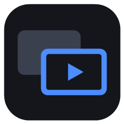
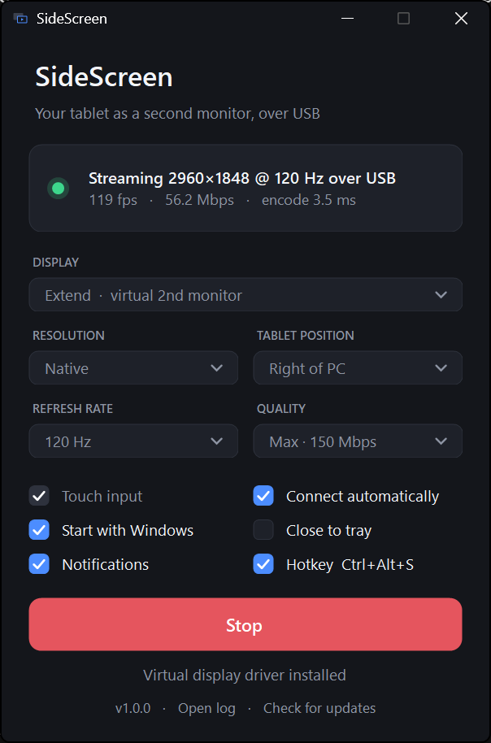
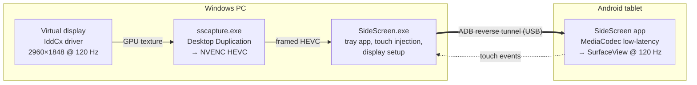

<div align="center">



# SideScreen

**Turn an Android tablet into a real second monitor for Windows, over a USB cable.**
Full resolution, 120 Hz, touch input, a few milliseconds of encode time, no Wi-Fi and no subscription.

[](https://github.com/unlimiteq/SideScreen/releases/latest)
[](https://github.com/unlimiteq/SideScreen/actions/workflows/build.yml)
[](LICENSE)




[**Download**](https://github.com/unlimiteq/SideScreen/releases/latest) ·
[Quick start](#quick-start) ·
[How it works](#how-it-works) ·
[Compatibility](#compatibility) ·
[FAQ](#faq)

</div>

---

## Features

|  |  |
| --- | --- |
| 🖥️ **A real extended display** | Windows sees a genuine second monitor (virtual display driver): drag windows onto it, set it left/right/above/below, use it in Display Settings like any screen. |
| ⚡ **120 Hz at native resolution** | 2960 × 1848 @ 120 Hz on a Galaxy Tab S8 Ultra, captured and encoded entirely on the GPU (~4 ms per frame). |
| 🔌 **USB only** | The picture travels over the cable through an ADB tunnel. No network, no pairing, no lag spikes from Wi-Fi. |
| 👆 **Multi-touch** | Touches on the tablet become real Windows touch input, up to 10 fingers. |
| 🖱️ **Smooth pointer** | The mouse pointer is drawn on the tablet as an overlay, so it moves at full speed even while the picture is busy. |
| 🪞 **Mirror mode** | Show any existing screen on the tablet instead of extending. |
| 🧰 **Tray app** | Lives in the system tray with a status dot (green = streaming), Start/Stop from the menu or **Ctrl + Alt + S** from anywhere. |
| 🔔 **Alerts (optional)** | Notifications when the tablet connects, disconnects or streaming stops. One switch turns them off. |
| 🔁 **Hands-off** | Connect automatically when the tablet is plugged in, start with Windows, and reconnect by itself after dropped connections, app restarts and lock screens. |
| 📊 **Stats overlay** | Three-finger tap on the tablet shows fps, bitrate and decode time. |
| 🔒 **Private** | No accounts, no telemetry. The only network request is the update check, and only when you click it. |

## Quick start

1. **Tablet:** enable [Developer options → USB debugging](https://developer.android.com/studio/debug/dev-options#enable), plug it into the PC and accept the *Allow USB debugging* prompt.
2. **PC:** download `SideScreen-vX.Y.Z-win-x64.zip` from [Releases](https://github.com/unlimiteq/SideScreen/releases/latest), unzip it anywhere and run `SideScreen.exe`.
   It needs the [.NET 10 Desktop Runtime](https://dotnet.microsoft.com/download/dotnet/10.0); Windows offers the download if it is missing.
3. Click **Install virtual display driver** once (one admin prompt).
4. Press **Start**. The tablet app installs and opens by itself, and the tablet becomes your second screen.

> [!TIP]
> In Extend mode the tablet shows an empty part of your desktop until you move the mouse or a window onto it. With a black wallpaper that looks like a black screen. A banner on the tablet confirms the connection.

## Compatibility

| Component | Requirement | Notes |
| --- | --- | --- |
| **Windows** | Windows 11, Windows 10 (21H2+) x64 | Extend mode needs the virtual display driver (IddCx), included. |
| **GPU** | NVIDIA GeForce GTX 10-series or newer | NVENC HEVC is required. The display being captured must be driven by the NVIDIA GPU (true for the virtual display on Optimus laptops). AMD / Intel encoders are not supported yet. |
| **Android** | Android 11 (API 30) or newer | Needs a hardware HEVC decoder (virtually every tablet since 2018). |
| **Connection** | USB 2.0 or faster cable | USB 3 recommended for the *Max* quality setting. |

**Tested on**

| Tablet | Panel | Result |
| --- | --- | --- |
| Samsung Galaxy Tab S8 Ultra (SM-X900, Android 16) | 2960 × 1848 @ 120 Hz | ✅ 119–120 fps at native resolution, touch, Extend and Mirror |

Tested it on another device? Please [open an issue](https://github.com/unlimiteq/SideScreen/issues/new?template=device_report.yml) with the result so it can be added here.

## How it works

The tablet has no video input, so "second monitor over USB" really means *make Windows believe there is a monitor, and get its pixels onto the tablet as fast as possible*. Every stage is chosen to keep frames on the GPU and avoid queues.



| Stage | What happens | Why it is fast |
| --- | --- | --- |
| Virtual display | An indirect display driver gives Windows a real 2960 × 1848 @ 120 Hz monitor. | Windows composes it like any screen, so every app and game works. |
| Capture | Desktop Duplication wakes up exactly when a new frame is presented. | Event driven, no polling; the frame stays in VRAM. |
| Encode | NVENC HEVC with ultra-low-latency tuning, no B-frames, infinite GOP. | ~3.5–5 ms per frame; unchanged frames are not re-sent, and a few refinement frames sharpen still images. |
| Transport | Length-prefixed packets over `adb reverse` on the USB cable. | TCP_NODELAY, small send buffer so old frames are never queued. |
| Decode | Android MediaCodec with `low-latency` and no frame dropping. | Each frame is shown on the next panel refresh. |
| Pointer & touch | Pointer shape/position sent separately; touches injected with `InjectTouchInput`. | The pointer never waits for video encoding. |

The PC also sends a heartbeat every second, so the tablet can tell an idle desktop from a dead cable and show a clear *Connection lost* screen instead of a frozen picture.

## Using SideScreen

| Setting | What it does |
| --- | --- |
| **Display** | *Extend* adds the tablet as a new screen; *Mirror* shows an existing screen. |
| **Resolution** | Native, 2560 × 1600 or 1920 × 1200 (bigger text). Extend only. |
| **Tablet position** | Right, left, above or below your PC screen. Extend only. |
| **Refresh rate** | 120, 90 or 60 Hz. |
| **Quality** | 150 / 80 / 40 / 20 Mbps. Higher keeps small text sharper during motion. |
| **Touch input** | Pass tablet touches to Windows. |
| **Connect automatically** | Start streaming whenever the tablet is plugged in. After a manual Stop it waits for a re-plug. |
| **Start with Windows** | Launch into the tray at sign-in. |
| **Close to tray** | The ✕ button hides the window instead of quitting. |
| **Notifications** | Connect / disconnect / stopped alerts. |
| **Hotkey** | **Ctrl + Alt + S** starts and stops streaming from anywhere. |

All choices are remembered (`%LOCALAPPDATA%\SideScreen\settings.json`). Minimizing always goes to the tray.

**On the tablet:** three-finger tap toggles the stats overlay.

**Command line**

| Argument | Effect |
| --- | --- |
| `--start` | Start streaming as soon as the tablet is found. |
| `--mirror` | With `--start`: mirror the first screen instead of extending. |
| `--tray` | Start hidden in the tray. |
| `--exit` | Tell a running SideScreen to stop and quit. |

## FAQ

<details>
<summary><b>Is this really "like a monitor", or is it streaming?</b></summary>

Windows sees a real monitor, but the tablet's USB port cannot accept video, so the picture is encoded on the GPU and decoded on the tablet. SideScreen is built to make that step as close to invisible as possible: frame-accurate 120 Hz, a few milliseconds of encoding, no frame queues.
</details>

<details>
<summary><b>The tablet shows a black screen.</b></summary>

That is usually an empty part of your desktop. Move the mouse off the edge of your main screen (in the direction set by <i>Tablet position</i>) or drag a window over. The tablet also shows a "Connected to your PC" banner for a few seconds when the picture starts.
</details>

<details>
<summary><b>It says "Paused – Windows is showing a protected screen".</b></summary>

Windows does not allow capturing the lock screen or UAC prompts. The picture comes back automatically afterwards.
</details>

<details>
<summary><b>Tablet not found / "Allow USB debugging".</b></summary>

Enable USB debugging, use a data-capable cable, and accept the RSA prompt on the tablet (tick <i>Always allow</i>). If you use other Android tools, make sure they do not run a different version of adb at the same time.
</details>

<details>
<summary><b>Small coloured text looks slightly soft.</b></summary>

Tablet decoders only accept 4:2:0 video, which halves colour resolution. Choose <b>Max · 150 Mbps</b> quality; still images are refined to full quality within a few frames.
</details>

<details>
<summary><b>How do I remove the virtual display driver?</b></summary>

Device Manager → Display adapters → <i>Virtual Display Driver</i> → Uninstall device. Extra resolutions and refresh rates can be added in <code>C:\VirtualDisplayDriver\vdd_settings.xml</code>.
</details>

<details>
<summary><b>Where are the logs?</b></summary>

Click <b>Open log</b> in the window footer, or open <code>%LOCALAPPDATA%\SideScreen\log.txt</code>. Please attach it to bug reports.
</details>

## Building from source

Requirements: Windows 10/11 x64, [.NET 10 SDK](https://dotnet.microsoft.com/download/dotnet/10.0), Visual Studio 2022+ with **Desktop development with C++**, JDK 17+, and Android SDK *build-tools* and *platform* 34+ (via `ANDROID_HOME`, or placed in `tools\android-sdk`).

```powershell
git clone https://github.com/unlimiteq/SideScreen.git
cd SideScreen
.\build.ps1            # builds everything into .\dist
.\build.ps1 -Package   # also creates .\release\SideScreen-vX.Y.Z-win-x64.zip
```

No Gradle: the Android app is built directly with `aapt2 → javac → d8 → apksigner`, which keeps the build fast and the APK around 25 KB.

### Project layout

| Path | Language | Contents |
| --- | --- | --- |
| [`host/`](host) | C# (.NET 10, WinForms) | Tray app and GUI, ADB handling, display topology, touch injection, driver installer, settings |
| [`capture/`](capture) | C++ (D3D11, NVENC) | `sscapture.exe`: Desktop Duplication → NVENC HEVC, pointer tracking |
| [`android/`](android) | Java (no dependencies) | Tablet receiver: socket → MediaCodec → SurfaceView, touch, overlays |
| [`driver/`](driver) | — | Signed Virtual Display Driver binaries and the mode list SideScreen uses |
| [`.github/`](.github) | — | CI, issue and PR templates |

## Contributing

Bug reports, device test results and pull requests are welcome. See [CONTRIBUTING.md](CONTRIBUTING.md). For security issues, see [SECURITY.md](SECURITY.md).

## Credits

- [Virtual Display Driver](https://github.com/VirtualDrivers/Virtual-Display-Driver) (MIT) for the signed IddCx virtual monitor.
- [NVIDIA Video Codec SDK](https://developer.nvidia.com/video-codec-sdk) header (MIT) for NVENC.
- Android platform-tools (`adb`) from the Android Open Source Project.

Full notices: [THIRD_PARTY_NOTICES.md](THIRD_PARTY_NOTICES.md).

## License

[MIT](LICENSE) © unlimiteq

<sub>SideScreen is an independent project. It is not affiliated with or endorsed by Samsung, NVIDIA, Google, Microsoft, or the makers of any other second-screen software. All trademarks belong to their owners.</sub>
